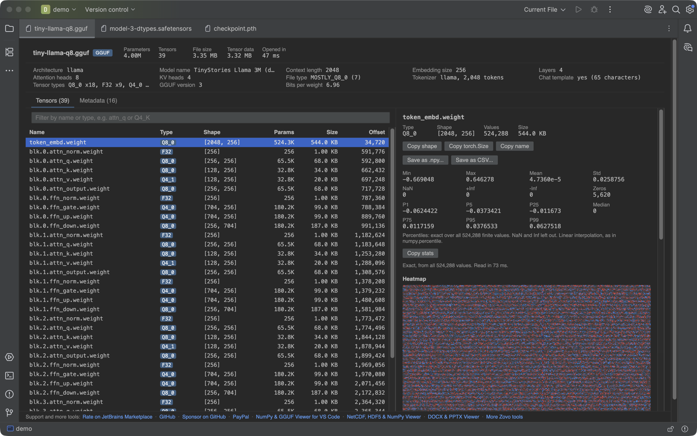

# GGUF & Safetensors Viewer for JetBrains IDEs

Open GGUF (.gguf), Safetensors (.safetensors), PyTorch (.pt, .pth, .ckpt, pytorch_model.bin) and NumPy (.npy, .npz) model files in a read-only viewer inside PyCharm, IntelliJ IDEA, DataSpell, CLion, GoLand, WebStorm and the other IDEs on the IntelliJ Platform (2025.2 and newer).

Double-click a model file in the Project view. The IDE no longer says "binary file". You see every tensor with its dtype, shape and size, the model metadata and the parameter count, and you can look at the values of any tensor without loading the model in Python.

## What it shows

### GGUF (llama.cpp, Ollama, LM Studio)
- The tensor list with the quantization type of each tensor (Q4_K, Q8_0, IQ4_XS, BF16 and more), and the bits per weight of the file.
- Model facts: architecture, model name, context length, embedding size, layers, attention heads, KV heads, tokenizer, chat template and file type.
- Every metadata key. Long values, such as the chat template and the token list, are folded.

### Safetensors
- The header and its `__metadata__`, with dtype (F32, F16, BF16, F8 and the integer types), shape and byte size for each tensor.

### PyTorch
- `.pt`, `.pth` and `.ckpt` checkpoints, both zip archives and older pickle files, and `pytorch_model*.bin`. The pickle is read as data. Nothing in the file is run.
- A plain-text `.pth` path file from site-packages, a `.pt` page template or a `.bin` file that is not a PyTorch archive keeps opening in its usual editor. The plugin checks the first bytes before it takes the file.

### NumPy
- `.npy` arrays and the array list of `.npz` archives.

### For the tensor you pick
- Min, max, mean, std, NaN and Inf counts, then the exact median and percentiles. Copy stats as text.
- A histogram, a heatmap for 2D tensors and an image view for H x W x 3 arrays. Quantized GGUF tensors are decoded for this.
- A value table with paging and Copy values. Save a tensor or a slice as `.npy` or CSV.

## Large files

The viewer reads the file by byte range and never loads it whole. A GGUF model opens from its header, so a 4 GB or a 70 GB file is listed in about a second. Values are read only for the tensor you pick, with a sample of 2 million values for the stats of very large tensors.

## Privacy

Everything is read-only and offline. The viewer makes no network calls and never changes your file. The page runs in the IDE's built-in browser (JCEF) on a private origin and can read only the file of its own tab.

Without JCEF (remote development, some Linux setups) the tab shows the GGUF or safetensors header parsed in Kotlin, with an "Open in Default App" button.

## Install

Settings, Plugins, Marketplace, search for "GGUF". Or download the zip from the Marketplace page and use "Install Plugin from Disk".

## Build

- The plugin: `./gradlew test buildPlugin verifyPlugin` (JDK 21 toolchain, IntelliJ Platform Gradle plugin 2.20, IC 2025.2.6.4). Gradle needs no Node: the viewer bundle is committed in `src/main/resources/web`.
- The viewer bundle: `cd web && npm ci && npm run bundle && npm test`. The tensor core in `web/src/tensor/core` and the page in `web/src/tensor/webview` come from the VS Code extension [NPZ & NPY Viewer, PyTorch PTH, GGUF & Safetensors](https://marketplace.visualstudio.com/items?itemName=zovo.tensor-viewer) 0.5.1, unchanged, and its core tests run here on the same files.

## Support and more tools

- [Sponsor on GitHub](https://github.com/sponsors/theluckystrike) or [donate with PayPal](https://www.paypal.com/paypalme/najzzz) if this viewer saves you time.
- [NPZ & NPY Viewer, PyTorch PTH, GGUF & Safetensors](https://marketplace.visualstudio.com/items?itemName=zovo.tensor-viewer) for VS Code, Cursor and Windsurf.
- [NetCDF, HDF5 & NumPy Viewer](https://plugins.jetbrains.com/plugin/35879) for JetBrains IDEs.
- [DOCX & PPTX Viewer](https://plugins.jetbrains.com/plugin/35878) for JetBrains IDEs.
- All Zovo tools: [theluckystrike on GitHub](https://github.com/theluckystrike).

Issues and ideas: [GitHub issues](https://github.com/theluckystrike/tensor-viewer-jetbrains/issues).

## License

MIT. Third-party notices: [THIRD-PARTY-NOTICES.txt](THIRD-PARTY-NOTICES.txt).
